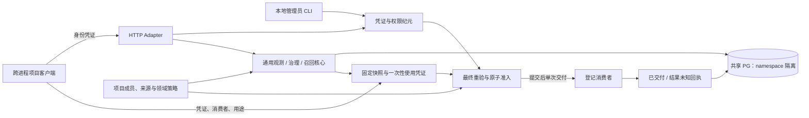

# 通用记忆远程接入 v1（G5）

状态：可选 HTTP Adapter 已实现；接入方仍需部署自己的身份、来源、策略与登记消费者。知语桌面继续使用原有本地 Adapter，不共享旧表、不自动改成网络依赖。

## 角色与流程

核心管理观测、候选、审核、依赖、上下文和使用准入；HTTP 只承载这些行为。项目 Adapter 负责真实身份、成员权限、来源版本、来源权限和消费者；业务策略只建议分类与期限。服务没有接管业务当前状态，也不推断模型是否采纳了记忆。



被控对象是“某个固定上下文能否交给某个登记消费者”。观测输入是数据库中的当前凭证、成员权限、来源完整版本、授权、复查期限与策略版本。准入事务持有这些记录的共享锁以及凭证行更新锁，审计提交成功后才调用消费者。事务提交失败时既不消费凭证，也不发送。

数据库是共享可信基础设施；HTTP 调用方不拥有 SQL 权限。namespace 来自认证记录，不从请求体、URL、owner 或模型参数推导。共享部署只覆盖新通用表和项目显式带 namespace 的来源/权限表；旧知语 schema 没有因此获得多租户能力。对象文件、向量索引、跨地域复制不在当前实现范围。

## 身份与管理员

`createServiceIdentityProvider` 是 PG Adapter 的服务端装配能力；HTTP 没有发证、改权限、切租户或改接收地址的入口。

- 身份凭证为 256 位随机 bearer，数据库只存摘要，绑定 tenant/project/principal、允许/拒绝权限、有效期、revoked 和 epoch。
- 每次请求先认证；每次保存、精确读取、审核、召回、凭证状态读取和最终使用又在事务中重验。`denied` 优先于 `allowed`。
- `replacePermissions` 递增 epoch，旧使用凭证不会因恢复授权而复活。`revoke` 永久停用该身份凭证并递增 epoch；恢复需签发新身份凭证。
- 管理动作写不可改写的身份事件，记录操作者。DB 管理员属于受信边界；不能把 DB 凭据提供给远程调用方。

管理员从项目真实身份系统确认 namespace 与角色后，在受保护的本地 JSON 文件填写 `identity: {namespace:{tenantId,projectId},principalId}`、`allowed`、`expiresAt`、`actor` 和 `outputFile`。`allowed` 为实际需要的 `propose/review/revise/recall/read/receipt/use` 子集；审核人应另配凭证，业务代理不默认拥有 review。

```powershell
# MEMORY_SERVICE_DATABASE_URL 通过私有进程环境注入，指向独立记忆库。
node --import tsx apps/service/admin.ts init
node --import tsx apps/service/admin.ts issue D:/private/memory-issue.json
node --import tsx apps/service/admin.ts permissions D:/private/memory-permissions.json
node --import tsx apps/service/admin.ts revoke D:/private/memory-revoke.json
```

`permissions` 文件包含 `id/allowed/denied/actor`；`revoke` 文件包含 `id/actor`。CLI 不在 stdout 输出令牌，输出文件以排他创建写入；Windows 部署须由运维配置私有目录 ACL，POSIX 的 0600 不替代 Windows ACL。发证后磁盘写失败时按身份事件核对并撤销该凭证，重新发证；不要假装跨数据库与文件系统原子。

项目成员、文档、来源授权由项目 Adapter 自己供应；发身份凭证不能自动创建来源权限或审核记录。示例使用 `demo_dev_*` 表与研发策略，其他项目应替换这些实现，不直接照搬角色授权。

## 传输接口

所有入口要求 `Authorization: Bearer <身份凭证>`；POST 要求 UTF-8 JSON。无 cookie 身份、无浏览器跨域授权，带 Origin 的请求拒绝。服务端请求体上限 256 KiB、请求/请求头超时；不解析压缩请求。失败返回明确 code，存储或审计异常返回 503，不能变成空列表。错误响应不含 SQL、令牌或私人原文。

| 路径 | 行为 |
| --- | --- |
| GET `/v1/capabilities` | 当前 namespace、R/K/U、来源/策略/消费者及覆盖边界 |
| POST `/v1/records/commands` | G1 观测命令，同 commandId 幂等 |
| POST `/v1/records/query` | G1 current/evidence/receipt 精确读取 |
| POST `/v1/commands` | G4 propose/review/revise/retire；保持审核/CAS/幂等语义 |
| POST `/v1/read` | current/receipt/use_receipt，治理读取不能冒充使用准入 |
| POST `/v1/evidence` | 固定来源版本精确摘录 |
| POST `/v1/recall` | 召回快照供展示；返回 JSON 本身没有出站权限 |
| POST `/v1/use/prepare` | `{recall:{scope,query,maxBytes},consumerId,purpose}`：召回并签发一次性凭证 |
| POST `/v1/use/dispatch` | `{credential,consumerId,purpose}`：最终重验并交付服务端登记消费者 |
| POST `/v1/use/status` | 同上三个字段，查询 issued/expired/admitted/dispatched/outcome_unknown 与 admissionId |

命令协议继续为 `general-memory.v1-draft`，传输能力标识为 `general-memory.http.v1`。当前是已列出 facet 的实现，并未把设计中的全部拟议命令伪装成支持。严格拒绝未知请求字段；调用方不能传 namespace、已核验状态、可替换 Pack、URL 或任意 proof。

`createRemoteMemoryClient` 可直接在另一个 Node 进程调用这些路径；不需要引入 Next、Brain、知语 session 或旧表。客户端只允许 HTTPS，或 IP 字面量回环 HTTP；禁止重定向，不自动重试。示例服务只监听 127.0.0.1，服务进程的 `MEMORY_SERVICE_PORT` 决定端口；`MEMORY_SERVICE_CONSUMER_URL` 是运维登记的本地测试接收端，不能由请求替换。

必需消费者配置缺失、数据库不可用或必需 schema 尚未初始化时，示例不会报告 ready。显式启动示例（先提供私有数据库环境、运行 init，并由项目准备成员、来源授权与真实本地接收端）：

```powershell
$env:MEMORY_SERVICE_PORT = '3640'
$env:MEMORY_SERVICE_CONSUMER_URL = 'http://127.0.0.1:3641/model'
node --import tsx apps/service/main.ts
```

```ts
const remote = createRemoteMemoryClient("https://memory.internal.example/", privateToken);
const { pack, use } = await remote.request("/v1/use/prepare", {
  recall: { scope: "pipeline", query: "retry", maxBytes: 16384 },
  consumerId: "demo.local-model", purpose: "ci-review",
});
// pack 只供展示和核对，交付内容取自服务端保存的快照。
await remote.request("/v1/use/dispatch", {
  credential: use.credential, consumerId: use.consumerId, purpose: use.purpose,
});
```

## 远程使用凭证与异常恢复

使用凭证与身份凭证分别管理。前者为 256 位随机令牌，数据库仅存令牌摘要及固定 Pack，绑定 namespace/principal、身份凭证 id+epoch、consumer、purpose、Pack hash、Pack 内版本集合（保存在固定快照中）、策略 id/version 摘要与 60 秒有效期。

新进程从数据库恢复快照，不能从客户端 JSON 恢复签封。最终准入重新检查已审核状态、版本、完整来源版本、权限、复查到期和策略版本；所有来源检查都通过同一 PG 事务 Adapter。等待全部来源锁后还会再次验证身份、使用凭证及所有已检查知识/来源的期限，避免等待期间到期仍发送。版本或授权服务故障均停止交付。策略实现更改必须提高策略版本，不能修改代码却声称原策略版本仍有效。服务进程时钟须同步；生产部署应监测时钟偏移。

并发消费凭证时只允许一个事务成功。消费和 `use_admitted` 原子提交后，进程崩溃或网络响应丢失可能留下 admitted；这表示可能已经发出，不能自动再发。使用 `/v1/use/status` 对账，必要时由有权限的管理员检查接收端再决定下一次业务动作。`issued` 也可能表示另一个请求尚在途，不能据此签发新凭证重复执行。

消费者异常、发送后审计失败记为 `outcome_unknown`，响应尽可能携带 admissionId；凭证保持已消费，不会因异常解锁重发。网络超时无法取得响应时，客户端应保存该使用凭证用于状态查询。`dispatched` 表示消费者调用返回且交付审计提交；示例响应 `output.acknowledged` 仅表示测试接收端返回 200，不代表模型采用、业务执行或资金动作成功。核心没有独立业务确认状态，没有收到业务确认时不能显示“业务完成”。

撤权以已提交的准入为线性化边界；已经交付的私人内容无法追回。暂停新使用可撤销身份凭证或拒绝 use 权限；停服务不会启动业务 worker。更改凭证权限、来源、审核/策略或复查期限需要重新 prepare；不能通过更换 commandId 自动延长记忆期限。

服务只保证经过登记网关的交付。远程 U 目前针对经过审核的知识及 Pack 中的来源摘录；G1 原始观测的独立读取仍为 R 级，没有单独远程使用凭证。外部客户端拿到可展示文本后自行发送的绕过路径不在 U 覆盖内；当前声明 bounded recall、registered edges only、无独立业务核实。生产公开部署还需要运维提供 TLS 终止、网络访问控制、速率/并发限制、监控和私有凭证注入，本次没有开启公网监听。

## 存储、生命周期与回退

`general_memory_remote_use_g5` 按 tenant/project/principal 隔离，凭证消费状态永久保留至运维明示的保留策略。使用凭证 60 秒到期是使用权限到期，不会偷偷延长知识或来源期限。固定 Pack 含私人内容，当前不做自动清理以免破坏对账；生产接入须按项目数据保留政策安排显式维护，不宜无限增长。身份事件、治理历史、命令和使用审计均不可改写。

服务迁移为独立显式初始化，普通知语启动不运行。部署应使用同一版本的核心、Adapter 和策略；滚动升级期间版本不匹配阻断旧凭证，不能回退成跳过重验。回退只停止新服务、保留其数据库和审计，知语继续本地调用。不会删除已提交命令或回滚业务审核。

验收入口为 `examples/memory-project/service-acceptance.ts`：新建一次性测试库，两个真实服务进程、客户端进程与本地接收端完成正负闭环；重启恢复、跨 namespace、同主体不同凭证、撤权、来源变化、到期、并发和延迟提交失败均需通过。测试结果由 `npm run test:integration` 写入 `.runtime/`；日常知语库不得作为这些故障注入的目标。
